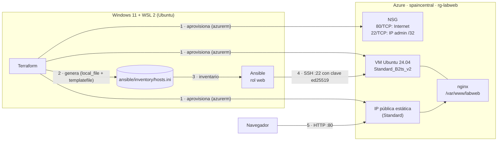
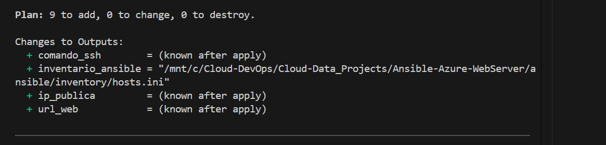
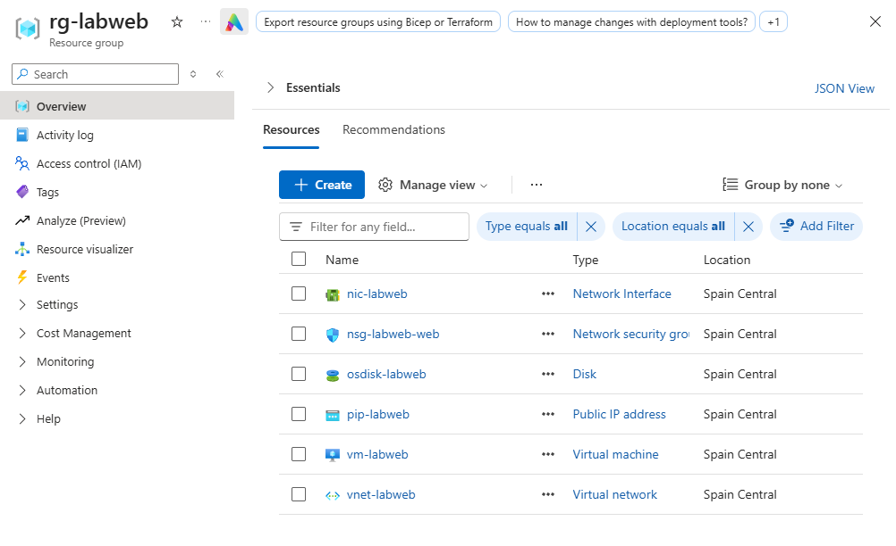
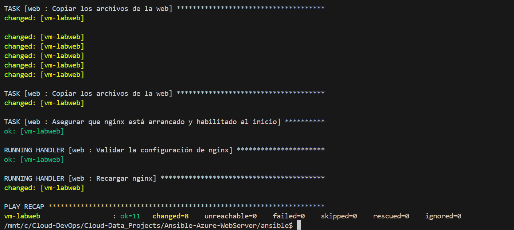
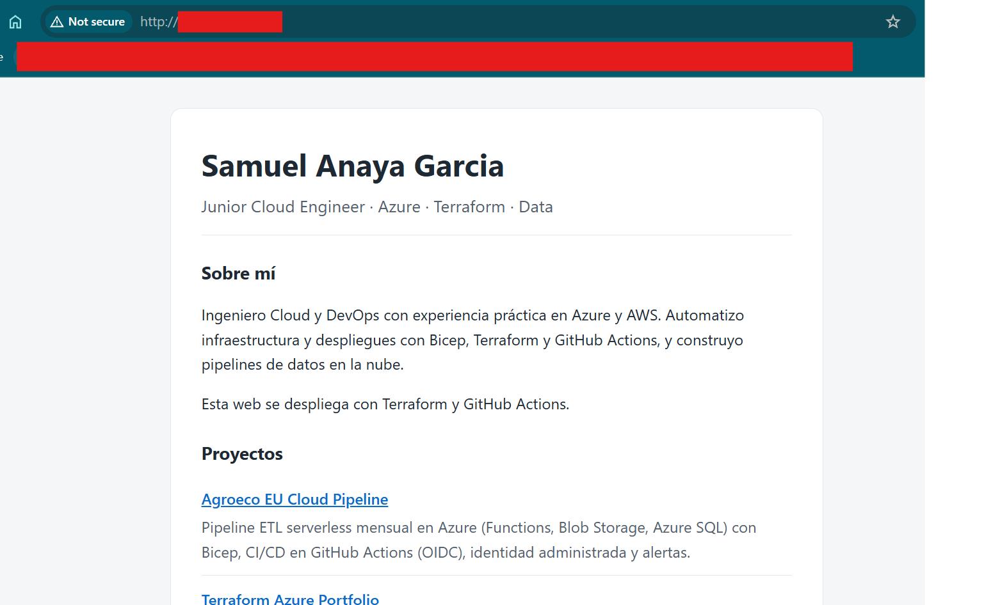
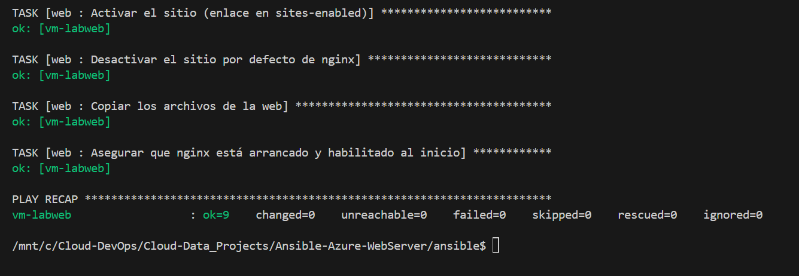
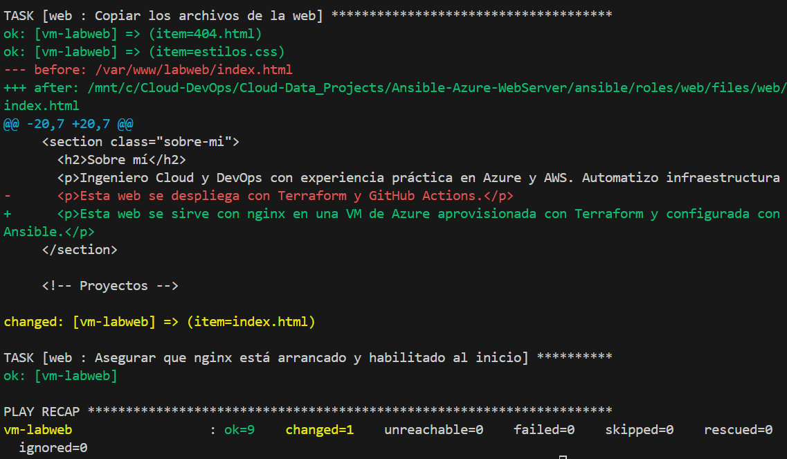
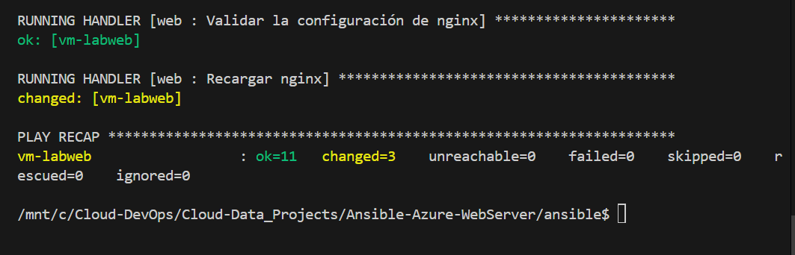
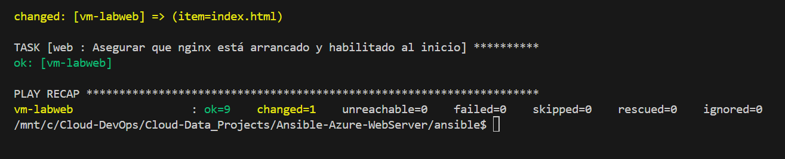
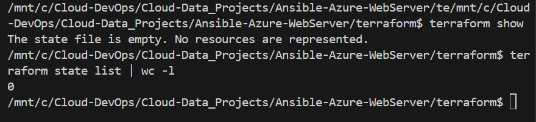

# Ansible-Azure-WebServer

**Terraform aprovisiona, Ansible configura.** Este proyecto despliega en Azure una VM Linux con su red y su IP pública, la configura como servidor web con nginx y publica una web estática. Al terminar, destruye toda la infraestructura.


## Qué hace

Cada herramienta tiene una responsabilidad:

- **Terraform** crea la infraestructura en Azure: grupo de recursos, VNet, subred, NSG, IP pública estática, NIC y una VM Ubuntu Server 24.04 LTS con acceso solo por clave SSH. A partir de la IP real de la VM, **genera el inventario de Ansible**, así que no hay ningún paso manual entre las dos herramientas.
- **Ansible** se conecta por SSH y configura la VM con el rol `web`: instala nginx, despliega la configuración del sitio desde una plantilla Jinja2, publica la web y garantiza que el servicio está activo.

Sobre ese despliegue se ejecutan seis experimentos que muestran las propiedades del enfoque declarativo:

| | Experimento | Qué demuestra |
|---|---|---|
| A | Primera ejecución | Ansible lleva la VM del estado inicial al deseado (`changed=8`) |
| B | Segunda ejecución | **Idempotencia**: sin cambios no se modifica nada (`changed=0`) |
| C | `--check --diff` | **Vista previa** del cambio exacto sin aplicarlo, y aplicación posterior |
| D | Cambio en la plantilla de nginx | Los **handlers** recargan nginx solo cuando cambia su configuración |
| E | Borrado manual en la VM | **Corrección de drift**: Ansible detecta y restaura el estado declarado |
| F | `terraform destroy` | Ciclo de vida completo: todo se elimina y no quedan costes |

## Diagrama del flujo



| Paso | Herramienta | Resultado |
|---|---|---|
| 1 | `terraform apply` | Red, seguridad, IP pública y VM creadas en Azure |
| 2 | `terraform apply` (`local_file`) | `hosts.ini` con la IP de la VM y el usuario |
| 3–4 | `ansible-playbook site.yml` | nginx instalado y configurado, web publicada |
| 5 | Navegador | La web responde en `http://<ip-publica>` |
| — | `terraform destroy` | Toda la infraestructura eliminada |

## Tecnologías y versiones

| Componente | Versión / valor |
|---|---|
| Terraform | 1.17.2 (`~> 1.17`) |
| Provider `hashicorp/azurerm` | 5.14 (`~> 5.14`) |
| Provider `hashicorp/local` | 2.9 (`~> 2.9`) |
| Ansible | ansible-core 2.22.0 (instalado con pipx) |
| Azure CLI | 2.91.0 |
| VM | `Standard_B2ts_v2` (2 vCPU, 1 GB) en `spaincentral` |
| Imagen | `Canonical:ubuntu-24_04-lts:server:latest` (Gen2, x64) |
| Entorno de ejecución | Windows 11 + WSL 2 (Ubuntu) |

`.terraform.lock.hcl` incluye los hashes de los providers para `linux_amd64` y `windows_amd64`.

## Estructura del repositorio

```
Ansible-Azure-WebServer/
├── terraform/
│   ├── versions.tf                  # versiones de Terraform y providers
│   ├── providers.tf                 # provider azurerm (suscripción vía ARM_SUBSCRIPTION_ID)
│   ├── variables.tf                 # variables con validación
│   ├── locals.tf                    # nombres, etiquetas e imagen
│   ├── main.tf                      # RG, VNet, subred, NSG, IP pública, NIC y VM
│   ├── inventory.tf                 # genera el inventario de Ansible
│   ├── templates/inventory.ini.tftpl
│   ├── outputs.tf                   # IP pública, URL de la web y comando SSH
│   ├── terraform.tfvars.example     # plantilla de variables (terraform.tfvars no se versiona)
│   └── .terraform.lock.hcl
├── ansible/
│   ├── ansible.cfg
│   ├── site.yml                     # playbook principal
│   ├── inventory/                   # hosts.ini lo genera Terraform (no se versiona)
│   └── roles/web/
│       ├── defaults/main.yml        # variables del rol
│       ├── tasks/main.yml           # apt, nginx, sitio, web, servicio
│       ├── handlers/main.yml        # validar y recargar nginx
│       ├── templates/labweb.conf.j2 # configuración del sitio nginx
│       └── files/web/               # index.html, estilos.css, 404.html
├── docs/
│   ├── TROUBLESHOOTING.md
│   └── capturas/                    # capturas y su índice (LEEME.md)
├── .gitattributes                   # finales de línea LF
├── .gitignore
├── CLAUDE.md
└── README.md
```

## Requisitos

- Una **suscripción de Azure** con cuota para 2 vCPU de la serie B en `spaincentral`, y los resource providers `Microsoft.Compute` y `Microsoft.Network` registrados.
- **Windows 11 con WSL 2 (Ubuntu).** Todos los comandos se ejecutan en Ubuntu, aunque los archivos se editen en Windows.
- En Ubuntu: **Terraform** (repositorio oficial de HashiCorp), **Ansible** (con pipx) y **Azure CLI** (paquete de Linux).
- Una **clave SSH ed25519** en `~/.ssh` de WSL.
- **Git en WSL** con identidad propia y acceso a GitHub (ver abajo), solo para versionar y publicar el repositorio.

### Configuración de Git en WSL

El Git de Ubuntu no comparte la configuración con Git for Windows, así que la identidad se define también en WSL. Para hacer `push` con la sesión de GitHub ya iniciada en Windows, WSL usa como *credential helper* el Git Credential Manager de Git for Windows:

```bash
git config --global user.name "<usuario-github>"
git config --global user.email "<id>+<usuario-github>@users.noreply.github.com"   # email noreply de GitHub
git config --global credential.helper "/mnt/c/Program\ Files/Git/mingw64/bin/git-credential-manager.exe"
```

En el repositorio, además, `git config core.autocrlf false` (finales LF) y `git config core.fileMode false`, porque en `/mnt/c` todos los archivos aparecen con permisos `777`.

### Particularidades de Windows + WSL resueltas desde el diseño

| Problema | Solución aplicada |
|---|---|
| Ansible ignora un `ansible.cfg` situado en un directorio *world-writable* como `/mnt/c` | `ANSIBLE_CONFIG` con la ruta absoluta, definida en `~/.bashrc` |
| En `/mnt/c` no se pueden aplicar permisos `600`, y SSH rechaza la clave | La clave vive en `~/.ssh` de WSL; Terraform y Ansible la referencian ahí |
| Los archivos editados en Windows pueden llegar a Linux con CRLF | `.gitattributes` con `eol=lf` y `git config core.autocrlf false` |
| Azure CLI y Terraform de WSL son instalaciones distintas de las de Windows | `az login` dentro de WSL y comprobación con `which az` (`/usr/bin/az`) |

## Pasos para reproducirlo

Se ejecutan en Ubuntu (WSL), desde la raíz del repositorio clonado en `/mnt/c/...`.

### 1. Preparar la sesión de Azure

```bash
az login
az account set --subscription "<NOMBRE_O_ID>"
export ARM_SUBSCRIPTION_ID=$(az account show --query id -o tsv)

# Registrar los resource providers (solo la primera vez en la suscripción)
az provider register -n Microsoft.Compute --wait
az provider register -n Microsoft.Network --wait

# Clave SSH (si no existe)
ssh-keygen -t ed25519 -C "lab-ansible-azure" -f ~/.ssh/lab_azure_ed25519
```

### 2. Aprovisionar con Terraform

```bash
cd terraform
cp terraform.tfvars.example terraform.tfvars
IP=$(curl -4 -s https://ifconfig.me)
sed -i "s/^ip_admin *=.*/ip_admin = \"$IP\"/" terraform.tfvars

terraform init
terraform fmt -check -recursive
terraform validate
terraform plan -out=tfplan        # revisar: 9 to add, regla SSH con la IP propia /32
terraform apply tfplan
terraform output
```

> ⚠️ **Revisa el plan antes de aplicarlo.** Desde el `apply`, la VM, el disco y la IP pública generan costes por hora.

### 3. Configurar con Ansible

```bash
cd ../ansible
export ANSIBLE_CONFIG="$PWD/ansible.cfg"
ansible --version | grep "config file"   # debe apuntar a ansible/ansible.cfg
ansible web -m ping
ansible-playbook site.yml
curl -sI "http://$(cd ../terraform && terraform output -raw ip_publica)" | head -1   # HTTP/1.1 200 OK
```

### 4. Destruir la infraestructura

```bash
cd ../terraform
ssh-keygen -R "$(terraform output -raw ip_publica)"
terraform plan -destroy -out=destroy.tfplan
terraform apply destroy.tfplan
az group exists -n rg-labweb             # false
```

> ⚠️ **Destruye siempre la infraestructura al terminar la sesión** para no generar costes.

## Seguridad

- **Acceso SSH solo por clave.** `disable_password_authentication = true`; la VM no tiene contraseña.
- **El puerto 22 solo está abierto a una IP (`/32`),** recibida como variable validada. El 80 está abierto a Internet porque la web es pública. El resto lo bloquean las reglas por defecto del NSG.
- **IP pública Standard**, segura por defecto: sin una regla explícita en el NSG no entra tráfico.
- **nginx no revela su versión** (`server_tokens off`), y cada cambio de configuración se valida con `nginx -t` antes de recargar.
- **Ningún secreto en Git:** `terraform.tfvars`, el state, el inventario generado y las claves están en `.gitignore`. La suscripción se lee de `ARM_SUBSCRIPTION_ID`.
- **`host_key_checking = False` solo para el laboratorio.** La VM se recrea con frecuencia y puede recibir la misma IP con otra huella. En producción se registran las huellas en `known_hosts` o se usa `StrictHostKeyChecking=accept-new`.

## Costes

Mientras la infraestructura existe se facturan, por horas, la VM `Standard_B2ts_v2`, su disco del sistema operativo (HDD estándar) y la IP pública Standard. La red virtual, la subred y el NSG no tienen coste. El proyecto está pensado para ejecutarse en una sesión y destruirse al terminar.

## Resultados

| Experimento | PLAY RECAP | Resultado |
|---|---|---|
| A · Primera ejecución | `ok=11 changed=8` | nginx instalado y web publicada; handlers ejecutados |
| B · Idempotencia | `ok=9 changed=0` | Ningún cambio, ningún handler |
| C · `--check --diff` / aplicación | `ok=9 changed=1` / `ok=9 changed=1` | Diff mostrado sin aplicar; después aplicado |
| D · Cambio en la plantilla | `ok=11 changed=3` → `ok=9 changed=0` | Handler solo cuando cambia la configuración |
| E · Drift | `ok=9 changed=1` | `index.html` borrado a mano y restaurado (403 → 200) |
| F · Destrucción | 9 recursos destruidos | State vacío; `rg-labweb` no existe |

### Experimento A: primera ejecución

El primer `ansible-playbook site.yml` sobre la VM recién aprovisionada por Terraform terminó con:

```
vm-labweb : ok=11 changed=8 unreachable=0 failed=0 skipped=0 rescued=0 ignored=0
```

- **7 tareas cambiaron el sistema:** caché de apt, instalación de nginx, carpeta de la web, configuración del sitio, activación del sitio, desactivación del sitio `default` y copia de la web.
- **Se ejecutaron los dos handlers** (`Validar la configuración de nginx` y `Recargar nginx`). La recarga cuenta como el octavo cambio.
- `curl -I` devolvió `HTTP/1.1 200 OK` con `Server: nginx`, sin número de versión (`server_tokens off`).
- La web se muestra correctamente en el navegador.

### Experimento B: idempotencia

Segunda ejecución de `ansible-playbook site.yml` sin ningún cambio en el código ni en la VM:

```
vm-labweb : ok=9 changed=0 unreachable=0 failed=0 skipped=0 rescued=0 ignored=0
```

- **Todas las tareas terminaron en `ok`.** Ansible comprobó que el estado de la VM ya era el declarado y no modificó nada.
- **No se ejecutó ningún handler**, porque ninguna tarea notificó un cambio. Por eso hay 9 `ok` en lugar de 11.
- El playbook se puede ejecutar tantas veces como haga falta: solo actúa cuando el estado real difiere del deseado.

### Experimento C: vista previa con `--check --diff` y aplicación

Se cambió una frase de `roles/web/files/web/index.html`, la copia de la web dentro del rol.

| Ejecución | Tarea «Copiar los archivos de la web» | PLAY RECAP | Web en la VM |
|---|---|---|---|
| `ansible-playbook site.yml --check --diff` | `ok` para `404.html` y `estilos.css`; `changed` para `index.html`, con el diff de la línea (`-` antigua, `+` nueva) | `ok=9 changed=1`, sin handlers | Sin cambios: texto antiguo |
| `ansible-playbook site.yml --diff` | El mismo diff; solo `index.html` en `changed` | `ok=9 changed=1`, sin handlers | Texto nuevo (verificado con `curl` y en el navegador) |

- **El modo check no modificó la VM.** Mostró exactamente qué cambiaría, y la ejecución real aplicó ese mismo cambio y nada más.
- **No hubo handlers**, porque cambiar un archivo estático no requiere recargar nginx.
- **La web del proyecto anterior no cambió.** La copia de Azure Storage sigue con el texto original: el rol trabaja sobre su propia copia de los archivos.
- Para que se viera el diff, la copia se hace archivo a archivo. Con un directorio como origen, `copy` no muestra el diff (ver [TROUBLESHOOTING, incidencia 9](docs/TROUBLESHOOTING.md)).

### Experimento D: el handler solo se ejecuta cuando cambia la configuración

Se añadió a la plantilla `labweb.conf.j2` la directiva `add_header X-Gestionado-Por "Ansible" always;`. Antes del cambio, la respuesta HTTP no incluía esa cabecera.

| Ejecución | Tarea de la plantilla | Handlers | PLAY RECAP |
|---|---|---|---|
| Con la plantilla modificada (`--diff`) | `changed`, con el diff de las líneas añadidas | `Validar la configuración de nginx` (`ok`) y `Recargar nginx` (`changed`) | `ok=11 changed=3` |
| Siguiente ejecución, sin cambios | `ok` | Ninguno | `ok=9 changed=0` |

- **Los tres cambios de la primera ejecución** fueron la plantilla, la recarga de nginx y la caché de apt. Esta última se actualizó porque había pasado más de una hora desde el experimento A (`cache_valid_time: 3600`); no tiene relación con el handler.
- **`nginx -t` validó la configuración antes de recargar.** Un error de sintaxis habría detenido el play sin afectar al servicio en marcha.
- Tras la recarga, `curl -I` devolvió `X-Gestionado-Por: Ansible`: nginx aplicó la configuración nueva sin reiniciarse.
- **Sin cambios en la configuración, el handler no se ejecuta.** Ansible no recarga servicios innecesariamente.

### Experimento E: corrección de drift

Se simuló un cambio manual fuera de Ansible borrando la página de inicio directamente en la VM:

```bash
ssh -i ~/.ssh/lab_azure_ed25519 azureuser@"$IP" 'sudo rm -v /var/www/labweb/index.html; ls -l /var/www/labweb/'
curl -sI "http://$IP" | head -1        # HTTP/1.1 403 Forbidden
```

| Paso | Resultado |
|---|---|
| Tras el borrado manual | En la carpeta solo quedan `404.html` y `estilos.css`; la web responde `HTTP/1.1 403 Forbidden` |
| `ansible-playbook site.yml --check --diff` | Drift detectado sin corregirlo: `index.html` en `changed` con diff de archivo nuevo; `ok=9 changed=1` |
| `ansible-playbook site.yml --diff` | Restaurado: `ok` para `404.html` y `estilos.css`, `changed` para `index.html`, sin handlers; `ok=9 changed=1` |
| Comprobación final | `curl -sI "http://$IP" \| head -1` devuelve `HTTP/1.1 200 OK` |

- **El modo check sirve para auditar.** Detecta desviaciones respecto al estado declarado sin modificar el servidor.
- **La ejecución normal corrige solo lo que se ha desviado.** Los demás archivos y la configuración de nginx no se tocan, y por eso no hay handlers.
- **El rol es la fuente de verdad.** El archivo restaurado contiene el texto nuevo del experimento C, que es la versión del rol, no la que hubiera antes en el servidor.

### Experimento F: destrucción de la infraestructura

La destrucción se hizo en dos pasos, con un plan guardado, para revisar exactamente qué se iba a eliminar antes de aplicarlo:

```bash
# Borrar las huellas de la VM de known_hosts (había 3, una por tipo de clave de host)
ssh-keygen -R "$(terraform output -raw ip_publica)"

# Plan de destrucción guardado y revisión del resumen
terraform plan -destroy -out=destroy.tfplan
terraform show destroy.tfplan | grep -E "will be destroyed|^Plan:"

# Aplicar exactamente el plan revisado
terraform apply destroy.tfplan

# Comprobaciones
terraform show                       # The state file is empty. No resources are represented.
terraform state list | wc -l         # 0
az group exists -n rg-labweb         # false
rm -f destroy.tfplan tfplan          # planes obsoletos
```

| Comprobación | Resultado |
|---|---|
| Plan de destrucción | 9 recursos `will be destroyed`; `Plan: 0 to add, 0 to change, 9 to destroy.` |
| Aplicación | 9 recursos destruidos; el último, `azurerm_resource_group.rg` (`Destruction complete after 26s`) |
| State | Vacío (`terraform state list` devuelve 0 recursos) |
| Azure | `az group exists -n rg-labweb` devuelve `false` |
| Inventario de Ansible | Eliminado: `local_file` forma parte del state y se destruye con el resto |

- **`plan -destroy -out` + `apply` equivale a `terraform destroy`.** La diferencia es que separa la revisión de la ejecución, igual que el despliegue.
- **La infraestructura deja de generar costes.** Todo el entorno puede recrearse desde el código con `terraform apply` + `ansible-playbook site.yml`.

### Comparativa: IaaS con Ansible frente a PaaS con Azure Storage

La misma web estática se publicó antes en el proyecto [Terraform-Azure-Portfolio](https://github.com/SamAnaya11/Terraform-Azure-Portfolio) como *static website* de Azure Storage (PaaS). En este proyecto se sirve desde una VM Linux con nginx configurada con Ansible (IaaS).

| Aspecto | IaaS: VM + nginx + Ansible (este proyecto) | PaaS: static website en Azure Storage |
|---|---|---|
| Quién gestiona el servidor | El equipo: sistema operativo, parches, nginx | Azure: no hay servidor que mantener |
| Control de la configuración | Total: cabeceras, redirecciones, páginas de error, módulos de nginx | Limitado a documento índice y documento de error |
| Herramientas | Terraform (infraestructura) + Ansible (configuración) | Terraform (cuenta de almacenamiento) + subida de archivos |
| Coste | VM, disco e IP pública facturados por hora mientras existan | Almacenamiento y transacciones: céntimos al mes para una web pequeña |
| Superficie de ataque | SO expuesto, puerto SSH (restringido por NSG a una IP) | Sin SO ni SSH; solo el endpoint HTTP(S) del servicio |
| HTTPS | Requiere configurar certificados en nginx (no incluido en este laboratorio) | Incluido en el endpoint por defecto del servicio |
| Disponibilidad y escalado | Una sola VM: si se detiene, la web cae | Gestionados por Azure según la redundancia de la cuenta |
| Cuándo encaja | Cuando se necesita control del servidor o lógica en el lado del servidor | Webs puramente estáticas, con coste y mantenimiento mínimos |

**Conclusión.** Para una web puramente estática, PaaS es la opción más sencilla y barata. El enfoque IaaS demuestra el flujo completo de *Terraform aprovisiona, Ansible configura* y es el punto de partida cuando el servidor necesita una configuración que un servicio gestionado no permite.

## Capturas

Selección de las capturas más representativas. La lista completa, con el paso exacto de cada una, está en [`docs/capturas/LEEME.md`](docs/capturas/LEEME.md).

**Plan de Terraform:** 9 recursos a crear.


**Recursos en Azure:** grupo `rg-labweb`.


**Experimento A:** handlers y `PLAY RECAP` de la primera ejecución.


**Web publicada por nginx en la VM.**


**Experimento B:** idempotencia (`changed=0`).


**Experimento C:** `--check --diff`.


**Experimento D:** handler ejecutado tras cambiar la plantilla.


**Experimento E:** drift detectado en modo check.


**Experimento F:** state vacío tras la destrucción.


## Resolución de problemas

Las incidencias encontradas durante la ejecución están documentadas, con causa y solución, en [`docs/TROUBLESHOOTING.md`](docs/TROUBLESHOOTING.md):

1. WSL no estaba instalado.
2. `Invalid username` al crear el usuario de Ubuntu.
3. Comandos ejecutados en Git Bash en lugar de Ubuntu.
4. `AADSTS530035` (*security defaults*) con `az login --use-device-code`.
5. `ARM_SUBSCRIPTION_ID` con `\r` final: en WSL respondía el Azure CLI de Windows.
6. La validación de `ip_admin` rechaza una IPv6.
7. `AllocationFailed` para `Standard_B2ats_v2` en `spaincentral`.
8. VM y disco huérfanos fuera del state tras el fallo (`already exists`).
9. `--check --diff` no mostraba el diff al copiar un directorio completo.
10. Datos sensibles en capturas: `git grep` no revisa imágenes, y una imagen corregida tras `git add` debe volver a añadirse.

## Posibles ampliaciones

- HTTPS con certificado de Let's Encrypt gestionado desde el rol.
- State remoto en Azure Storage con bloqueo, para trabajo en equipo.
- CI con `terraform fmt`/`validate` y `ansible-lint` en cada pull request.
